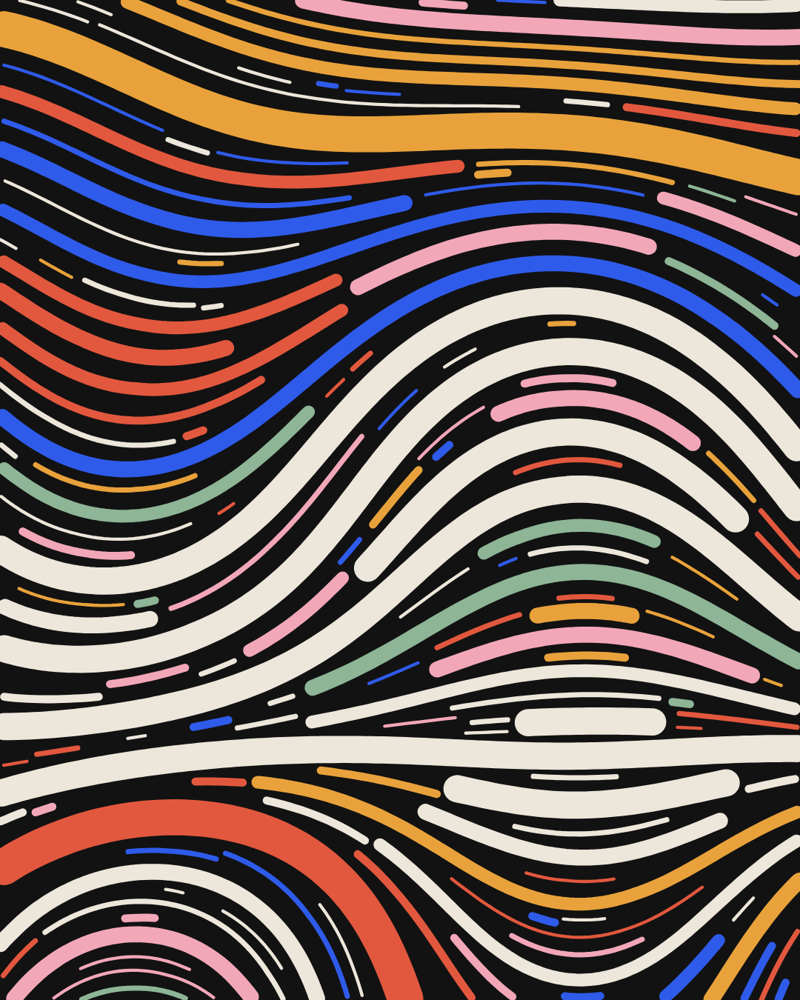
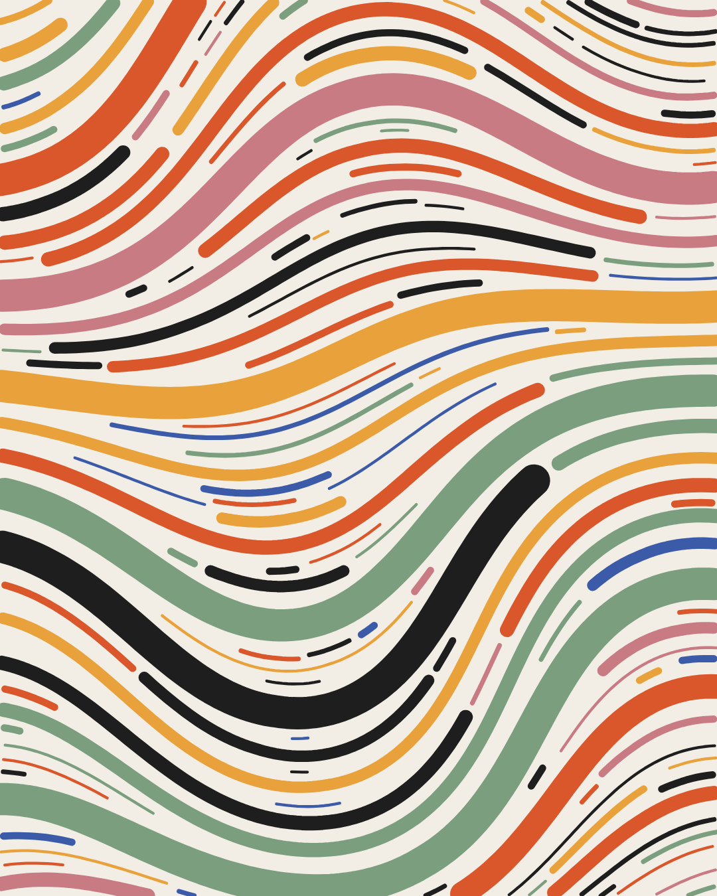
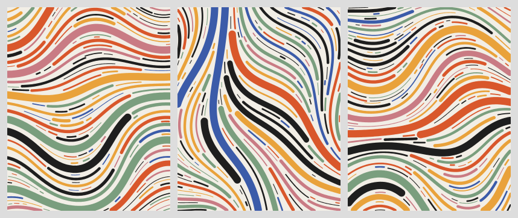

# generative-art · 用代码画生成艺术的 skill

不画画，写规则。这是一个给 Claude Code 用的 skill：按 5 条规则写代码生成流场线条画，适合做封面、海报、壁纸、头像、加载动画和票券图案。

<p>


</p>


## 5 条规则

1. **换种子，换张画。** 规则不动，只换随机起点。
2. **同种子可复现。** 同一个种子、同一份代码和参数，画出同一张图。
3. **色板加权。** 按权重抽颜色，主色占三成左右。
4. **每步 4px，间隔 5px，碰到就停。** 用占用网格保证线条之间留白。
5. **先大后小。** 先放粗线定结构，再用细线填缝。

## 安装

用 skills CLI（需要 Node.js）：

```bash
npx skills add chendaqing524-jpg/generative-art-skill
```

也可以手动安装：把 `skills/generative-art` 文件夹复制到 `~/.claude/skills/`（Windows 是 `C:\Users\<用户名>\.claude\skills\`）。

渲染 PNG 需要本机装有 Chrome 或 Edge，以及 Python 3。

## 用法

装好后直接提需求就行，比如：

- 帮我用生成艺术做一张 1080×1440 的小红书封面背景，深色底
- 给这 4 个用户 ID 各生成一个头像
- 同一套参数出 5 个版本让我挑

AI 会先问清用途，渲一张自己检查，按症状调参，再出系列，最后告诉你每张图的种子和参数，方便以后原样复现。

## 文件

| 路径 | 作用 |
|---|---|
| `skills/generative-art/SKILL.md` | 规则、工作流程和调参速查 |
| `skills/generative-art/scripts/gen.js` | 流场生成器 |
| `skills/generative-art/scripts/render.py` | 用无头 Chrome 或 Edge 渲染 PNG |
| `skills/generative-art/assets/template.html` | 起步模板 |

## 致谢

5 条规则整理自设计师观默的开源项目「每天一个设计风格」第 021 期：生成艺术（[guanmo-ai/design-style](https://github.com/guanmo-ai/design-style)）。流场技法参考了 Tyler Hobbs 的文章 [Flow Fields](https://www.tylerxhobbs.com/words/flow-fields)。本仓库的代码和示例图是另写、另生成的，没有使用原项目的代码和图片。

## English

A Claude Code skill that draws flow-field generative art with code, following five rules: a seed per image, the same seed reproduces the same image, a weighted palette, 4px steps with a 5px gap checked on an occupancy grid, and large lines first with small lines filling the gaps. Install with `npx skills add chendaqing524-jpg/generative-art-skill`, or copy `skills/generative-art` into `~/.claude/skills/`. Rendering needs Chrome or Edge and Python 3.

## License

[MIT](LICENSE)
